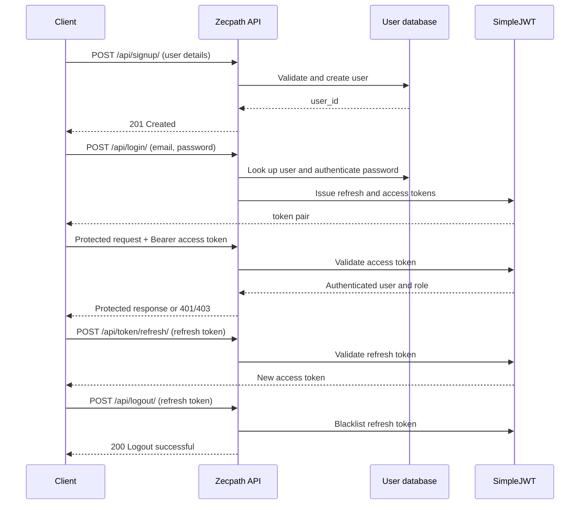

# Authentication Flow

This diagram reflects the implemented Zecpath authentication endpoints.

## Protected surfaces

- `GET /api/user-test/` is an authenticated smoke-test endpoint.
- `GET` and `POST /api/jobs/` require authentication; job creation is employer-only.
- `GET` and `POST /api/applications/` require authentication; application creation is candidate-only.
- Profile and resume endpoints require authentication and enforce the requested user's role.
- `GET /api/admin-control/` is restricted to users with the `ADMIN` role.
